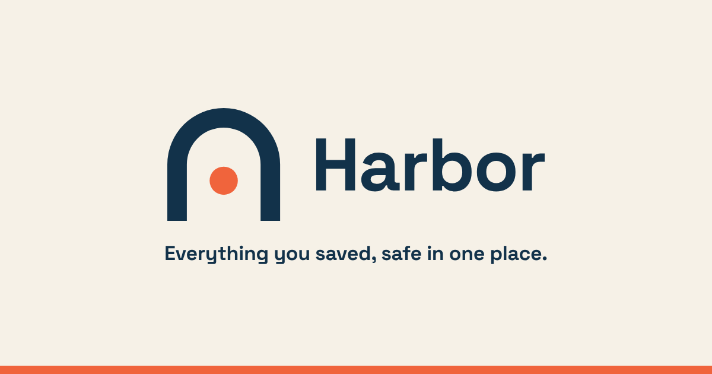
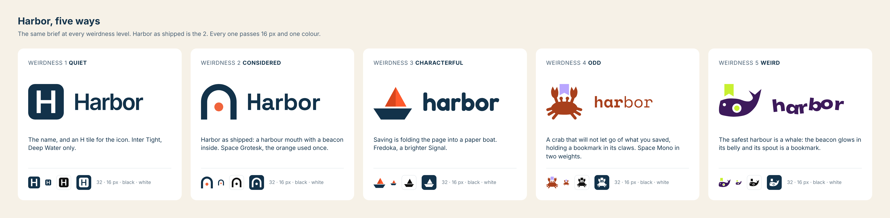
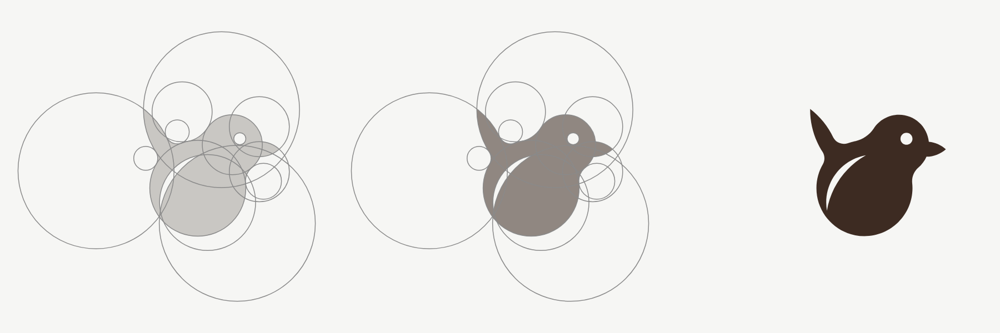
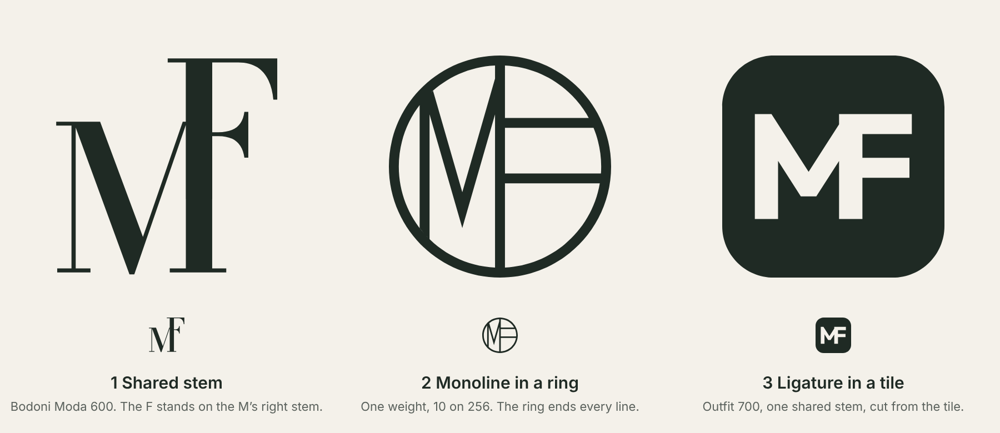
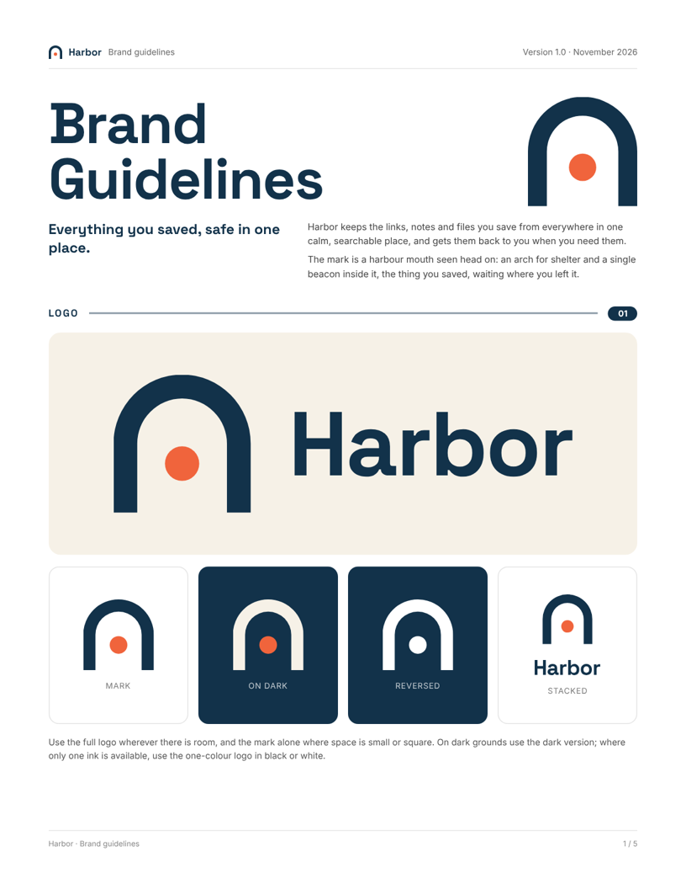
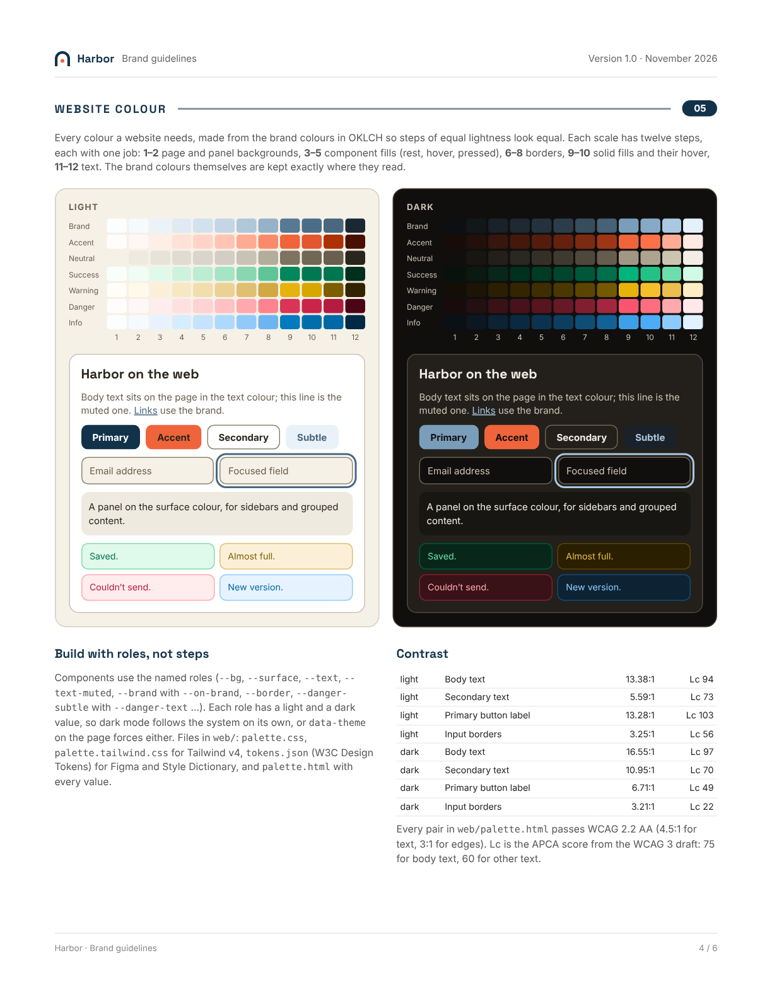

# brand-kit

A Claude Code plugin that designs a logo in SVG and exports the whole brand kit
around it: icons, brand guidelines, a website colour palette for light and dark
mode, an email signature, a business card, a slide template and social images,
all from one `brand.json`.

**See it at [mattblack.space/skills/brand-kit](https://mattblack.space/skills/brand-kit/)**,
built around the example brand Harbor.



## Install

In Claude Code (2.1.275 or later):

```
/plugin install brand-kit --marketplace mtblck/brand-kit
```

Or add the marketplace first, which works on older versions too:

```
/plugin marketplace add mtblck/brand-kit
/plugin install brand-kit@brand-kit
```

To have it in every session on a repo (including Claude Code on the web), add
this to the repo's `.claude/settings.json`:

```json
{
  "extraKnownMarketplaces": {
    "brand-kit": { "source": { "source": "github", "repo": "mtblck/brand-kit" } }
  },
  "enabledPlugins": { "brand-kit@brand-kit": true }
}
```

It's also in [mtblck/claude-marketplace](https://github.com/mtblck/claude-marketplace)
as `brand-kit@mtblck`.

## Use

Ask for what you need: "design a logo for my bakery, Crumb", "make favicons
from this SVG", "add a slide template to our brand kit". The `logo` skill asks
for a short brief and five quick creative-direction questions, shows concepts
and a typeface specimen, and checks in before it draws the final kit.

One of those questions is **weirdness**, from 1 (quiet and professional) to 5
(plain weird). It sets how far the ideas, type and colour may stray, never
whether the logo still works at 16 px and in one colour. Say it up front
("weirdness 4") or leave it out, and the first round shows one concept each at
2, 3 and 4 so you can pick by eye.



Round and figurative marks can be built on a **circle grid**: every curve an
arc of one set of circles, drawn in code with path booleans, with the
construction drawing to show for it (and on the guidelines' construction page).



Names with two words or initials always get a **monogram** concept, with the
structure chosen from the letters: a shared stem, a stepped serif, a monoline in
a ring, a weave, a knockout tile.



## What it does

- **`logo`** designs a logo in SVG. It works from a brief, writes concepts from
  different metaphors and structures, sets the name in many real Google Fonts
  on one numbered specimen sheet so the typeface is chosen by eye, draws the
  marks and lockups with scripts on a 256 grid, and exports everything from one
  `brand.json`.
- **`icons`** makes favicons, app icons and PWA icons from a logo that already
  exists (or a few matching UI icons), using the same export.

What one `node scripts/export.mjs brand.json` writes:

| Folder / file | Contents |
| --- | --- |
| `svg/` | every logo, its dark version, one-colour black and white versions |
| `png/` | every logo at 256–2048 px wide, transparent |
| `icons/` | `favicon.ico` (16/32/48), `favicon.svg`, `apple-touch-icon.png`, `icon-192/512.png`, `icon-maskable-512.png`, `app-icon-1024.png`, `site.webmanifest`, `head.html` |
| `check.png` | size ramp from 16 px, light and dark, one-colour tests, favicon in browser tabs, app icon on a home screen and under Android's mask |
| `brand-guidelines.pdf` (+ `.html`, one PNG per page) | printable US Letter brand guidelines: cover and logo versions; construction, clear space, minimum size, one colour, misuse and icons; typography; colour with HEX, RGB, CMYK and contrast; website colour |
| `pdf/` | every logo as a vector PDF, for print shops |
| `social/` | `og-image.png` (1200 × 630 link preview: logo, tagline, accent bar) and `avatar.png` (800 × 800, circle-safe) |
| `web/` | the website palette: 12-step OKLCH scales (brand, accent, tinted neutral, success, warning, danger, info) and light and dark roles (`--bg`, `--text`, `--brand`, `--on-brand`, …) as `palette.css`, a Tailwind v4 theme and W3C design tokens, with `palette.html` showing every value and its WCAG 2.2 and APCA contrast |
| `templates/` | email signature (HTML + text), business card (print PDF with bleed), slide template (`.pptx` + PDF) and social posts (square, portrait, story, Ko-fi cover, X header, each with a blank), with two pages about them in the guidelines |
| `README.md` | which file to use for what |
| `<name>-brand-kit.zip` | all of the above in one download |

Scripts (in `skills/logo/scripts/`, Node 18+):

- `brand.mjs`: drawing kit. Fetches Google Fonts and outlines text with
  `opentype.js` (installed once into `~/.cache/brand-kit`, not the project), plus
  geometry helpers and `lockup()`.
- `specimen.mjs`: the name in every face of the chosen typeface groups.
- `render.mjs`: PNGs of any SVG, or a numbered concept comparison sheet.
- `palette.mjs`: the website palette (also runs alone: `node palette.mjs brand.json`).
- `export.mjs`: everything above from `brand.json`.

Rendering uses Playwright's Chromium if it's installed (as in Claude's cloud
sessions) and never installs one. Fonts need network access to
`fonts.googleapis.com` and `fonts.gstatic.com`; the first run also needs the npm
registry for `opentype.js` and `pptxgenjs`.

`skills/logo/examples/harbor/` is a complete worked logo (a harbour arch with a beacon,
Space Grotesk wordmark): `node draw.mjs && node ../../scripts/export.mjs brand.json`.

`references/typefaces.json` lists around 70 Google Fonts that are free for
commercial logo use (SIL OFL or Apache 2.0), in eleven voices, each with text
faces that pair with it.





The process and craft rules are original, informed by reading
[kaankiziltug/logo-design-skill](https://github.com/kaankiziltug/logo-design-skill)
(MIT), OpenData's [svg-design skill](https://github.com/tryopendata/skills) and
its write-up "Using Claude as a logo design agency", and the Logo Creator skill
on MCP Market. No text or code was copied from them; see THIRD_PARTY_NOTICES.md.

## License

MIT. See [LICENSE](LICENSE).
